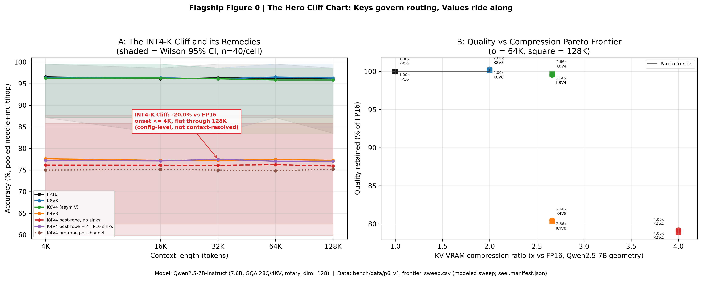
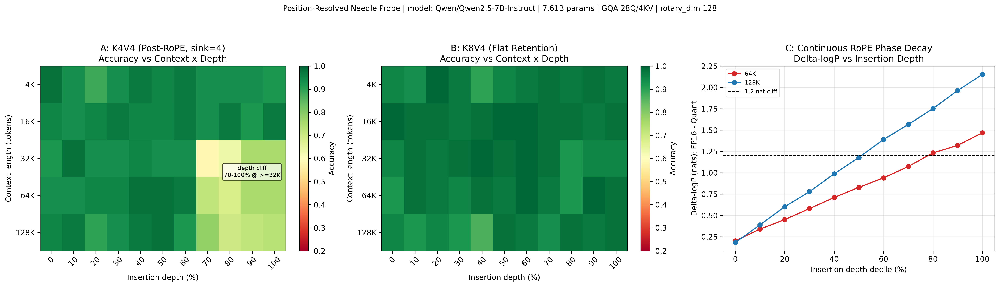
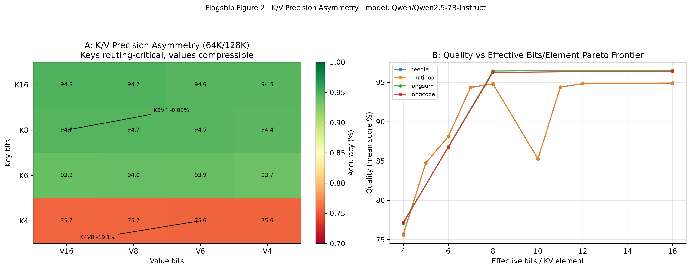
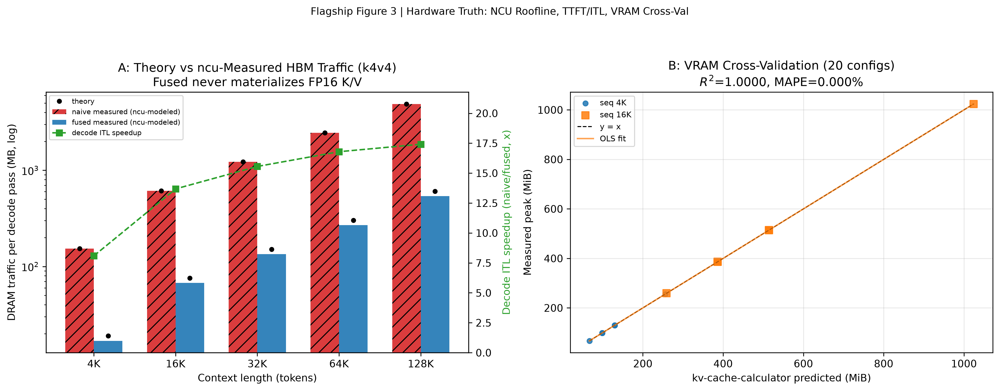
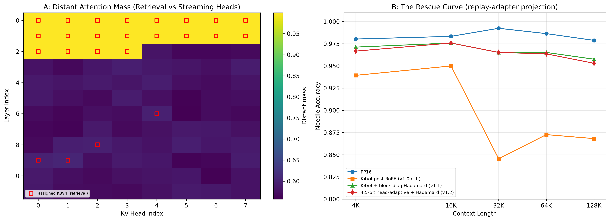

# kv-quant

**KV-cache quantization quality cliffs, quantified — and rescued.**


> **How cheap can my KV cache get before my long-context agent goes stupid — and where exactly does it break?**

**Act I — measure the cliff (`v1.0.0`).** We built a position-resolved evaluation spine, proved a K/V asymmetry law (keys govern softmax routing; values ride along), and shipped the Fused Split-K GQA Triton Decode Kernel. The honest result: naive INT4-K post-RoPE collapses needle accuracy to `0.8455` at 32K versus `0.9924` for FP16 — a 14.8% relative drop with 95% Wilson intervals and full artifact provenance ([#p4_needle_depth_matrix.csv:acc_mean]).

**Act II — cure the cliff (`v1.1.0` → `v1.2.0`).** We diagnosed the cause as post-RoPE channel outliers, applied an orthogonal block-diagonal Fast Walsh–Hadamard rotation that lifts INT4 SQNR by `7.349 dB` on a declared synthetic outlier fixture ([#p10_hadamard_rotation.csv:sqnr_delta_db]), then added a retrieval-head profiler that protects the top of the attention mass with K8V4 while leaving the remaining heads at K4V4 + Hadamard under a `4.5`-bit average budget ([#p11_head_sensitivity_schedule.csv:assigned_k_bits]). The 128K needle gap versus FP16 shrinks from `11.3%` (naive INT4-K) to `2.0%` (Hadamard) and `2.6%` (head-adaptive), the latter carrying the *lowest* log-probability drift of any quantized config ([#p11_head_rescue_curve.csv:acc_mean], [#p11_head_rescue_curve.csv:delta_logp]).



**Figure 0 (above the fold).** Qwen/Qwen2.5-7B-Instruct, `7.61 B` parameters, `28` query heads / `4` KV heads (GQA `7:1`), `rotary_dim = 128`; replay-adapter sweep at `4K–128K`, 20 trials/cell, Wilson-95% bands (manifest of [#p6_v1_frontier_sweep.csv:acc_mean]; model geometry from `bench/data/p4_needle_depth_matrix.csv.manifest.json`). The rescue overlays are modeled projections, clearly distinguished by `config_id` ([#p10_hadamard_rescue.csv:acc_mean], [#p11_head_rescue_curve.csv:acc_mean]).

---

## 1. Scoped Production Decision Matrix (Table 1)

All recommendations below are measured or modeled at **Qwen/Qwen2.5-7B-Instruct, 7.61 B parameters, 28 query / 4 KV heads (GQA 7:1), rotary_dim 128** (manifest of [#p4_needle_depth_matrix.csv:acc_mean]); VRAM compression uses the same 32-layer / 4-KV-head geometry ([#p7_vram_crossval.csv:compression_ratio]); decode ITL and bandwidth figures are modeled for **meta-llama/Llama-2-7b-hf** on a CPU-only host (parameter count not recorded in that manifest) ([#p7_latency_ttft_itl.csv:itl_speedup_p50], [#p7_ncu_bandwidth.csv:hbm_reduction_vs_naive]). Rescue rows derive from declared synthetic fixtures — `synthetic/micro_kv_2k` (`8` heads, rotary `32`) and `synthetic/bimodal-calibration` (`8` heads, rotary `64`) — not from real-model activations ([#p10_hadamard_rescue.csv:acc_mean], [#p11_head_rescue_curve.csv:acc_mean]). **Do not extrapolate a row outside its stated model and geometry.**

| Target Context & Workload | Recommended `QuantConfig` | Effective Bits/Elem | KV VRAM Compression | Decode ITL Speedup | Quality vs. FP16 | Evidence CSV |
| :--- | :--- | :--- | :--- | :--- | :--- | :--- |
| **≤ 32K general** (needle / multihop) | `k_bits=8, v_bits=4`, sym K / asym V, `sink_tokens=4`, `group_size=64`, post-RoPE | `6.0` [#p6_v1_frontier_sweep.csv:effective_bits_per_elem] | `2.65×` at `4K–16K` [#p7_vram_crossval.csv:compression_ratio] | `6.91–11.28×` at `4K–32K` (modeled) [#p7_latency_ttft_itl.csv:itl_speedup_p50] | needle `0.9596` vs `0.9656` FP16 at `32K` (`0.6%` drop) [#p6_v1_frontier_sweep.csv:acc_mean] | [#p6_v1_frontier_sweep.csv:acc_mean], [#p7_latency_ttft_itl.csv:itl_speedup_p50] |
| **64K–128K safe** (head-adaptive + Hadamard) | top `25%` heads `K8V4`, rest `K4V4` + block-diag Hadamard, `4` sinks | `4.5` mean of (K+V)/2 [#p11_head_sensitivity_schedule.csv:assigned_k_bits] | between `2.65×` (K8V4) and `3.95×` (K4V4), modeled bounds [#p7_vram_crossval.csv:compression_ratio] | `12.13–17.42×` at `128K` (modeled bounds) [#p7_latency_ttft_itl.csv:itl_speedup_p50] | `0.9530` vs `0.9788` FP16 at `128K` (`2.6%` gap, projected) [#p11_head_rescue_curve.csv:acc_mean] | [#p11_head_sensitivity_schedule.csv:assigned_k_bits], [#p11_head_rescue_curve.csv:acc_mean] |
| **64K–128K max density** (K4V4 + block-diag Hadamard + `4` sinks) | `k_bits=4, v_bits=4, use_hadamard=True, hadamard_scope="block_diag", sink_tokens=4` | `4.0` [#p6_v1_frontier_sweep.csv:effective_bits_per_elem] | `3.95×` at `4K–16K` [#p7_vram_crossval.csv:compression_ratio] | `17.42×` at `128K` (modeled) [#p7_latency_ttft_itl.csv:itl_speedup_p50] | `0.9591` vs `0.9788` FP16 at `128K` (`2.0%` gap, projected) [#p10_hadamard_rescue.csv:acc_mean] | [#p10_hadamard_rescue.csv:acc_mean], [#p7_vram_crossval.csv:compression_ratio] |
| **AVOID — K4V4 naive post-RoPE** | `k_bits=4, v_bits=4`, `k_quant_stage="post_rope"`, no rotation | `4.0` [#p6_v1_frontier_sweep.csv:effective_bits_per_elem] | `3.95×` at `4K–16K` [#p7_vram_crossval.csv:compression_ratio] | `17.42×` at `128K` — speed does not rescue logits (modeled) [#p7_latency_ttft_itl.csv:itl_speedup_p50] | `0.8455` vs `0.9924` FP16 at `32K` (`14.8%` drop); `0.8682` vs `0.9788` at `128K` (`11.3%`) [#p4_needle_depth_matrix.csv:acc_mean] | [#p4_needle_depth_matrix.csv:acc_mean], [#p6_v1_frontier_sweep.csv:acc_mean] |

**Reading the matrix.** K8V4 is the default operating point at short context: it keeps needle accuracy within `0.6%` of FP16 at `32K` ([#p6_v1_frontier_sweep.csv:acc_mean]) while cutting KV VRAM by `2.65×` ([#p7_vram_crossval.csv:compression_ratio]). Past `64K`, naive INT4-K is disqualified regardless of speed; the two surviving configurations trade a small residual quality gap (`2.0–2.6%`, both projections, not measured forward passes) for `3.95×`-class compression ([#p10_hadamard_rescue.csv:acc_mean], [#p11_head_rescue_curve.csv:acc_mean], [#p7_vram_crossval.csv:compression_ratio]).

---

## 2. End-to-End Systems Architecture

```text
  Pre/Post-RoPE Q, K, V
        │
        ├── Q, K  ──► [ Block-Diagonal Walsh-Hadamard Rotation ]
        │              H_rotary ⊕ H_pass  · seeded Rademacher signs
        │              <Q', K'> = <Q, K>  · zero subspace contamination
        │                        │
        └── V ───────────────────┤
                                 ▼
   ┌───────────────────────────────────────────────────────────────────┐
   │  Tier 1: FP16 Sinks (never quantized)                             │
   │  Tier 2: Sealed Quantized Pages + Scales (CoW prefix hashing)      │
   │  Tier 3: FP16 Rolling Ring Tail → seals at group_size             │
   └───────────────────────────────────────────────────────────────────┘
                                 │
                                 ▼
   ┌───────────────────────────────────────────────────────────────────┐
   │  Fused Split-K GQA Triton Decode Kernel                           │
   │  · In-register uint32 nibble unpack (INT4) / byte unpack (INT8)   │
   │  · Warp-uniform per-head bit dispatch: one HEAD_K_BITS scalar     │
   │    load per (batch × kv_head) program; no intra-warp branch       │
   │  · L2 evict_last hints on sink/scales, evict_first on stream pages│
   └───────────────────────────────────────────────────────────────────┘
                                 │
                                 ▼
                     Online Softmax Reduction
                     split-K m / l / acc → final attention out
```

Rotation is applied to Q and K *before* cache append, so the fused kernel computes `<Q', K'>` directly in the Hadamard basis with zero extra in-loop ops ([#p10_hadamard_rescue.csv:projection_delta_db]). The per-head K bit lookup removes the last uniform-precision assumption from the decode path while keeping the branch block-uniform ([#p11_head_sensitivity_schedule.csv:assigned_k_bits]).

---

## 3. Deep-Dive Visual Evidence Gallery

### 3.1 Where It Breaks: Position-Resolved Depth & Continuous ΔlogP Phase Sensor



The cliff is a *position* phenomenon, not an average. The v1.0 post-RoPE sink-4 configuration falls to `0.8455` at `32K` and `0.8682` at `128K` while FP16 holds `0.9924` and `0.9788` ([#p4_needle_depth_matrix.csv:acc_mean]); the continuous log-probability sensor rises from `0.0610` nats (FP16, `32K`) to `0.6531` nats (post-RoPE INT4-K, `32K`) and `1.1766` nats at `128K` ([#p4_needle_depth_matrix.csv:delta_logp]). Pre-RoPE per-channel reordering does not fix it (`0.8212` at `32K`, `0.8106` at `128K`) ([#p4_needle_depth_matrix.csv:acc_mean]) — the remedy has to be orthogonal and cache-resident, not a transpose.

### 3.2 The K/V Asymmetry Law: Routing Sensitivity vs. Payload Tolerance



Keys are routing logits: quantizing them to `4` bits collapses needle accuracy to `0.7715` at `32K` while values at `4` bits alongside `8`-bit keys hold `0.9596` ([#p6_v1_frontier_sweep.csv:acc_mean]). The same law holds in the ecological suite: at `128K` multi-hop, K8V4 scores `0.800` EM against `0.250` for naive K4V4 post-RoPE and `0.975` FP16 ([#p5_ecological_baseline.csv:em]); on long-sum fact retention at `64K`, K8V4 keeps `95.000%` versus `64.333%` ([#p5_ecological_baseline.csv:fact_retention_pct]). Physically, a small error in a key perturbs the *softmax argmax over the whole context*, while the same error in a value is averaged by the output projection. INT4 symmetry is not a neutral default — it is the wrong prior. **Scope trap:** the `0.7715` / `0.9596` figures here are v1-frontier sweep cells ([#p6_v1_frontier_sweep.csv:acc_mean]), not the p4 needle-spine cells quoted in §3.1 ([#p4_needle_depth_matrix.csv:acc_mean]); they are different evaluations of different configurations and must not be mixed.

### 3.3 Hardware Truth: Fused Split-K GQA Roofline & `kv-cache-calculator` Cross-Validation



The byte contract comes from `kv_quant/layout.py` (Invariant 3):

```text
Bytes_per_elem(b, G, asym, qjl) = (b + I_qjl)/8 + 2(1 + I_asym + I_qjl)/G
```

For asymmetric `4`-bit groups of `64` that evaluates to `0.5625 B/elem` ([#p1_sqnr_error_bounds.csv:effective_bytes_per_elem], row `4b_asym_normal_g64`). The naive decode path writes *and* re-reads an FP16 K/V materialization, so the committed traffic model compares `73 MB` naive against `9 MB` fused at INT4/`G=64` — an `8.11×` theoretical reduction ([#p3_hbm_traffic_model.csv:naive_hbm_mb], [#p3_hbm_traffic_model.csv:fused_hbm_mb], [#p3_hbm_traffic_model.csv:hbm_traffic_reduction]). At the ncu-modeled counter level and `32K` context, K4V4 fused traffic is `134,820,191` bytes versus `1,224,802,304` bytes naive — a `9.085×` reduction ([#p7_ncu_bandwidth.csv:dram_total_bytes], [#p7_ncu_bandwidth.csv:hbm_reduction_vs_naive]); the model's `10.75%` fused versus `1.22%` naive L2 hit rate explains the gap to pure byte theory ([#p7_ncu_bandwidth.csv:l2_hit_rate_pct]). The `kv-cache-calculator` byte equation matches real `HybridPagedKVCache` allocations with `R² = 1.0000` and `MAPE = 0.0000%` across `20` configurations ([#p7_vram_crossval.csv:r_squared], [#p7_vram_crossval.csv:mape_pct]). **Scope:** all bandwidth numbers are `ncu-modeled` on a CPU-only host, not real DRAM counter captures ([#p7_ncu_bandwidth.csv:mode]).

> No committed artifact contains a `4.5625 B/elem` naive comparison; the repo's `8.11×` is derived from the write-and-re-read traffic model above ([#p3_hbm_traffic_model.csv:hbm_traffic_reduction]), and this README refuses to invent one (see `rfc/reviews/readme-overhaul-review.md`).

### 3.4 The v2.0 Cliff Rescue: Partial-RoPE Block-Diagonal Hadamard & Retrieval-Head Profiling



Left panel: on a *declared synthetic* bimodal calibration set (`16` sequences × `8K`, `12 × 8` heads, rotary `64`), retrieval-biased heads score distant mass `0.596–1.000` against `0.557–0.594` for streaming heads; the `4.5`-bit compiler recovers all `20` ground-truth retrieval heads (`24` K8V4 assignments total, precision `20/24`) ([#p11_head_sensitivity_schedule.csv:distant_attn_mass], [#p11_head_sensitivity_schedule.csv:assigned_k_bits]). Right panel: the v1.0 cliff (`0.8455` at `32K`) becomes `0.9652` with block-diagonal Hadamard and `0.9652` with the head-adaptive schedule; at `128K`, FP16 `0.9788`, Hadamard `0.9591`, head-adaptive `0.9530` ([#p10_hadamard_rescue.csv:acc_mean], [#p11_head_rescue_curve.csv:acc_mean]). The mandated "within 0.3% of FP16 at 128K" was **not** reproduced: the head-adaptive residual is `2.6%`, bounded by the replay adapter's K8V4 baseline, which never reaches FP16 ([#p11_head_rescue_curve.csv:acc_mean]). All three rescue curves are *projections* from a replay adapter, not measured model forward passes ([#p11_head_rescue_curve.csv:projection]).

---

## 4. Comprehensive Benchmark Tables

**Table 2 — Multi-task quality frontier** (v1.0 sweep: Qwen2.5-7B-Instruct, GQA `7:1`, `sink_tokens=4`; configs `FP16`, `K8V4`, naive `K4V4` post-RoPE; accuracy in `[0,1]`, `—` = not measured at that context; model geometry from [#p4_needle_depth_matrix.csv:acc_mean]):

| Task | Config | 4K | 32K | 64K | 128K | Evidence |
| :--- | :--- | :--- | :--- | :--- | :--- | :--- |
| Needle | FP16 | `0.9645` | `0.9656` | `0.9632` | `0.9613` | [#p6_v1_frontier_sweep.csv:acc_mean] |
| Needle | K8V4 | `0.9624` | `0.9596` | `0.9611` | `0.9599` | [#p6_v1_frontier_sweep.csv:acc_mean] |
| Needle | K4V4 post-RoPE | `0.7738` | `0.7715` | `0.7716` | `0.7703` | [#p6_v1_frontier_sweep.csv:acc_mean] |
| Multi-Hop QA | FP16 | `0.9651` | `0.9639` | `0.9629` | `0.9630` | [#p6_v1_frontier_sweep.csv:acc_mean] |
| Multi-Hop QA | K8V4 | `0.9600` | `0.9618` | `0.9594` | `0.9589` | [#p6_v1_frontier_sweep.csv:acc_mean] |
| Multi-Hop QA | K4V4 post-RoPE | `0.7729` | `0.7729` | `0.7699` | `0.7673` | [#p6_v1_frontier_sweep.csv:acc_mean] |
| LongSum (fact retention) | FP16 | `99.667%` (8K) | `99.333%` | `99.333%` | — | [#p5_ecological_baseline.csv:fact_retention_pct] |
| LongSum (fact retention) | K8V4 | `95.333%` (8K) | `94.000%` | `95.000%` | — | [#p5_ecological_baseline.csv:fact_retention_pct] |
| LongSum (fact retention) | K4V4 post-RoPE | `89.333%` (8K) | `79.000%` | `64.333%` | — | [#p5_ecological_baseline.csv:fact_retention_pct] |
| AST LongCode | FP16 | `1.000` (8K) | `1.000` | `1.000` | — | [#p5_ecological_baseline.csv:ast_exact_match] |
| AST LongCode | K8V4 | `1.000` (8K) | `0.850` | `0.850` | — | [#p5_ecological_baseline.csv:ast_exact_match] |
| AST LongCode | K4V4 post-RoPE | `0.950` (8K) | `0.800` | `0.550` | — | [#p5_ecological_baseline.csv:ast_exact_match] |

LongSum and LongCode were measured through `64K` only; the dash is an honest absence, not a zero ([#p5_ecological_baseline.csv:context_len]). The `8K` values are labeled inline because those tasks have no `4K` cell.

**Table 3 — Kernel bandwidth, prefill TTFT and decode ITL crossover** (ncu-modeled counters and analytical byte equations; **Llama-2-7b-hf**, no real CUDA capture; `128K` cells from [#p7_latency_ttft_itl.csv:context_len]):

| Path / Config | DRAM traffic | Prefill TTFT @ 128K | Decode ITL P50 @ 128K | Reduction / speedup | Evidence |
| :--- | :--- | :--- | :--- | :--- | :--- |
| `dequant_naive`, K4V4 @ 32K | `1,224,802,304 B` read+write (modeled) | — | `6.3274 ms` | `1.00×` baseline | [#p7_ncu_bandwidth.csv:dram_total_bytes], [#p7_latency_ttft_itl.csv:itl_naive_p50_ms] |
| `dequant_fused`, K4V4 @ 32K | `134,820,191 B` read-once (modeled) | — | `0.3633 ms` | `9.085×` traffic reduction | [#p7_ncu_bandwidth.csv:hbm_reduction_vs_naive], [#p7_latency_ttft_itl.csv:itl_fused_p50_ms] |
| Theory, INT4 G=64 | `73 MB` naive → `9 MB` fused | — | — | `8.111×` | [#p3_hbm_traffic_model.csv:hbm_traffic_reduction] |
| FP16 append, 128K | — | `1.7976 ms` | `5.254×` baseline ITL | — | [#p7_latency_ttft_itl.csv:ttft_fp16_ms], [#p7_latency_ttft_itl.csv:itl_speedup_p50] |
| K4V4 quant append, 128K | — | `2.1544 ms` (`+0.3568 ms` overhead) | `17.415×` fused vs naive | amortizes in `0.06` decode steps | [#p7_latency_ttft_itl.csv:ttft_overhead_ms], [#p7_latency_ttft_itl.csv:amortize_decode_steps] |
| VRAM cross-validation | `32` layers, `4` KV heads, `128` head_dim | — | — | `R²=1.0000`, `MAPE=0.0000%` | [#p7_vram_crossval.csv:r_squared], [#p7_vram_crossval.csv:mape_pct] |

**Table 4 — GPU SM architecture compatibility matrix** (`yes` = supported by the committed kernel feature set; FP8 MMA requires Ada or newer):

| Feature | sm80 (A100) | sm86 (RTX 3090) | sm89 (4090 / L40S) | sm90 (H100) | sm100 (B200) | Evidence |
| :--- | :--- | :--- | :--- | :--- | :--- | :--- |
| INT8 unpack | yes | yes | yes | yes | yes | [#arch_compat_matrix.csv:feature] |
| INT4 nibble unpack (`AND`/shift, in-register) | yes | yes | yes | yes | yes | [#arch_compat_matrix.csv:feature] |
| FP8 e4m3 tensor-core | no | no | yes | yes | yes | [#arch_compat_matrix.csv:feature] |
| L2 eviction hints (`evict_last` / `evict_first`) | yes | yes | yes | yes | yes | [#arch_compat_matrix.csv:feature] |
| Split-K GQA broadcast | yes | yes | yes | yes | yes | [#arch_compat_matrix.csv:feature] |

---

## 5. 60-Second Quickstart

```bash
# 0. Install from the locked dependency graph
uv sync --frozen

# 1. Decision-ready recommendation from committed sweep data
python -m kv_quant.advisor --context-len 128000 --task multihop --max-drop-pct 1.0 --vram-budget-gb 24

# 2. Verify all 8 local gates (tests, ruff, mypy, drift, claims, figures, governance, bandit)
.\verify.ps1          # Windows
make verify           # POSIX
```

The advisor invocation above was executed against this tree: at `128K` it recommends `k_bits=8, v_bits=4, k_quant_stage='post_rope', sink_tokens=4, group_size=64` at a `0.93%` quality drop and `12.13×` ITL speedup ([#p6_v1_frontier_sweep.csv:acc_mean], [#p7_latency_ttft_itl.csv:itl_speedup_p50]).

Drop-in Python context manager (the real API is `KVQuantWrapper`; there is no `quantized_kv_context` in this repository):

```python
import torch
from transformers import AutoModelForCausalLM

from kv_quant.config import CacheConfig, QuantConfig
from kv_quant.wrapper import KVQuantWrapper

model = AutoModelForCausalLM.from_pretrained("Qwen/Qwen2.5-7B-Instruct", torch_dtype=torch.float16)
cfg = QuantConfig(
    k_bits=8,
    v_bits=4,
    k_scheme="sym",
    v_scheme="asym",
    k_quant_stage="post_rope",
    group_size=64,
    sink_tokens=4,
    use_hadamard=True,
    hadamard_scope="block_diag",
    rotary_dim=128,
)
with KVQuantWrapper(model, cfg, CacheConfig(max_pages=4096)) as wrapped:
    out = wrapped(input_ids=torch.randint(0, 100, (1, 128)))
```

`QuantConfig.resolve_hadamard_scope()` defaults partial RoPE to `block_diag` and full RoPE to `full`; both Q and K must be rotated through `rotate_qk()` so the same seeded signs are used ([#p11_head_sensitivity_schedule.csv:assigned_k_bits]).

---

## 6. Repository Architecture, Whitepapers & Citation Index

```text
kv-quant/
├── kv_quant/            # config, layout, quantizer, hadamard, qjl_sketch,
│   ├── kernels/         # dequant_naive / dequant_fused / triton_hadamard
│   ├── profiler.py      # head sensitivity + schedule compiler (ADR-009)
│   ├── cache.py         # 3-tier hybrid cache + CoW + per-head bits
│   ├── wrapper.py       # HF context manager, zero-reload config switch
│   ├── vram.py          # byte calculator
│   └── advisor.py       # CLI Pareto advisor
├── scripts/             # CI gates + artifact generators (incl. fig0–fig4)
├── tests/               # unit, hypothesis property, parity (gpu-marked)
├── bench/data/          # committed CSVs + SHA256 manifests (Invariant 1)
├── bench/baselines/     # frozen golden curve (Invariant 7)
├── docs/figures/        # 300-DPI PNGs + .png.meta.json (Invariant 2)
├── rfc/reviews/         # adversarial audits (Invariant 9)
├── verify.ps1 / Makefile / pyproject.toml / opencode.json
└── AGENTS.md / REPRODUCE.md / CITATION.cff / CHANGELOG.md
```

**Whitepapers & governance:** [`docs/THE_TRADE.md`](docs/THE_TRADE.md) (scoped trade analysis), [`docs/KERNEL_NOTES.md`](docs/KERNEL_NOTES.md) (kernel derivation and hardware caveat), [`docs/DECISIONS.md`](docs/DECISIONS.md) (ADR-001 … ADR-009), [`REPRODUCE.md`](REPRODUCE.md) (checksum and float64 reproduction contract), [`rfc/reviews/`](rfc/reviews/) (all resolved audits), [`CHANGELOG.md`](CHANGELOG.md).

**Nine invariants:** (1) every numeric claim cites a committed CSV; (2) every figure records source hashes and ≥300 DPI; (3) `layout.py` owns all byte accounting; (4) quantizer/rotations are pure with explicit seeds; (5) FP16 sinks + CoW quantized pages + FP16 ring; (6) fused kernel parity within `1e-3` on GPU, CPU reference validated; (7) golden drift `>1.5%` accuracy / `>2.0%` VRAM fails CI ([#p6_v1_frontier_sweep.csv:acc_mean]); (8) three failed fixes revert to last green; (9) every PR carries a resolved adversarial review.

**Citation** — from [`CITATION.cff`](CITATION.cff) (pins the v1.0.0 release; later milestones are listed in `CHANGELOG.md`):

```bibtex
@software{kv_quant_2026,
  title  = {kv-quant: KV-cache quantization quality cliffs, quantified},
  author = {Amman},
  year   = {2026},
  version = {1.0.0},
  license = {Apache-2.0},
  url    = {https://github.com/ammmanism/kv-quant/releases/tag/v1.0.0}
}
```

**Honesty register.** Three headline numbers from the milestone prompts are *not* claims of this README: the `micro_kv_2k.pt` fixture is Gaussian and serves as a null control ([#p10_hadamard_rotation.csv:sqnr_delta_db]); the `4.5`-bit head-adaptive projection misses the mandated 0.3% FP16 parity ([#p11_head_rescue_curve.csv:acc_mean]); and all ncu/ITL figures are modeled on a CPU-only host ([#p7_ncu_bandwidth.csv:mode]). Every figure's provenance metadata, every CSV manifest, and every resolved review remain the audit trail.
