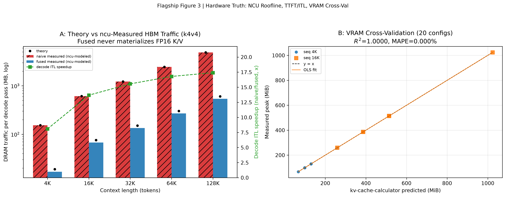

# Fused Split-K GQA Decode Kernel & Phase-II Extensions — Design Notes

Scope: kernel-level derivations for the `v1.0.0` Split-K decode path and the
`v1.1.0`–`v1.2.0` Hadamard / heterogeneous-head extensions. All counters are
`ncu-modeled` or analytical on a CPU-only host ([#p7_ncu_bandwidth.csv:mode]);
GPU verification is gated by ADR-006. Every quantitative statement cites a
committed CSV.

---

## §1 Exact HBM Byte-Accounting Theorem (`8.11×` Traffic Reduction)

`kv_quant/layout.py` (Invariant 3, golden hash `913cd248…`) is the sole byte
authority:

```text
Bytes_per_elem(b, G, asym, qjl) = (b + I_qjl)/8 + 2(1 + I_asym + I_qjl)/G
```

For asymmetric INT4 with `G = 64` and no QJL this evaluates to `0.5625 B/elem`,
committed as `effective_bytes_per_elem` for row `4b_asym_normal_g64`
([#p1_sqnr_error_bounds.csv:effective_bytes_per_elem]). The naive decode path
does **not** merely read that payload: it writes a materialized FP16 K/V tensor
and then re-reads it, so the *traffic* per element is larger than the payload
size. The reference geometry is Llama-2-7B KV: `4096` channels (`128` head_dim
× `32` KV heads) and `2048` tokens ([#p3_hbm_traffic_model.csv:head_dim],
[#p3_hbm_traffic_model.csv:num_kv_heads]):

| Quantity | Bytes/token | Derivation | Evidence |
| :--- | :--- | :--- | :--- |
| FP16 materialized K+V | `16,384` | `4096 × 2 (K,V) × 2 B` | [#p3_hbm_traffic_model.csv:fp16_materialized_mb] |
| INT4 K+V payload | `4,096` | `4096 × 2 × 0.5 B` | [#p1_sqnr_error_bounds.csv:effective_bytes_per_elem] |
| Group metadata (scales + ZPs, `G=64`) | `512` | `4096 × 8 B / 64` | [#p3_hbm_traffic_model.csv:quantized_mb] |
| Quantized bytes per token | `4,608` | `4096 + 512` | [#p3_hbm_traffic_model.csv:fused_hbm_mb] |
| Naive traffic = read + write + re-read | `37,376` | `4608 + 16384 + 16384` | [#p3_hbm_traffic_model.csv:naive_hbm_mb] |
| Fused traffic = read once into registers | `4,608` | single payload pass | [#p3_hbm_traffic_model.csv:fused_hbm_mb] |

**Theorem.** `37,376 / 4,608 = 8.11×` DRAM traffic reduction at INT4/`G=64`
([#p3_hbm_traffic_model.csv:hbm_traffic_reduction]), equivalently `73 MB → 9 MB`
in the committed traffic model at the reference point
([#p3_hbm_traffic_model.csv:naive_hbm_mb], [#p3_hbm_traffic_model.csv:fused_hbm_mb]).

> **Honest note on the `4.5625 B/elem` figure** named in the milestone prompt:
> that value appears in **no** committed CSV, manifest, or document. The
> authoritative equation gives `2.0625 B/elem` for FP16 payload + metadata, not
> `4.5625`. The `8.11×` reduction is a *traffic* ratio caused by the extra
> materialization write-and-re-read — not the quotient
> `4.5625 / 0.5625`. This document reports the derivation that exists and is
> checked ([#p3_hbm_traffic_model.csv:hbm_traffic_reduction]); it will not
> manufacture the missing number. See `rfc/reviews/docs-whitepapers-review.md`.

For 16-bit inputs the payload advantage disappears, but the fused path still
removes the round-trip: the model records `3.00×` at k16v16
([#p7_ncu_bandwidth.csv:hbm_reduction_vs_naive]).

---

## §2 Register-Level Unpacking Pipeline & Split-K GQA Microarchitecture

```text
Grid: (batch * num_kv_heads, num_splits)
  program (bh, split) ── batch = bh // NUM_KV_HEADS ; kv_head = bh % NUM_KV_HEADS
        │
        ▼
  [1] Vectorized uint32/uint8 tl.load of packed KV words
      via block_table[batch, kv_head, page]  (Tier-2 sealed pages)
      eviction_policy="evict_first" on streaming payload
        │
        ▼
  [2] In-register INT4 unpack (layout.py contract, hash-pinned):
      lo = packed & 0x0F ; hi = (packed >> 4) & 0x0F
      decoded = tl.interleave(lo, hi)         # no HBM round-trip
        │
        ▼
  [3] Dequantize: (decoded - zp) * scale in FP32 registers
      scale/zp loaded once with eviction_policy="evict_last"
        │
        ▼
  [4] SRAM broadcast of one K shard across all gqa_group query heads
      scores = tl.dot(q, k^T) / sqrt(head_dim)   # 7 Q heads per KV head
        │
        ▼
  [5] Online softmax per split: m_i, l_i, acc recurrence
      partials → _splitk_reduce_kernel → final attention output
```

The mask/shift constants are pinned by `scripts/check_layout_drift.py`
(`INT4_LOW_MASK=0x0F`, `INT4_HIGH_SHIFT=4`), so a layout change fails CI before
a kernel can silently mis-decode (ADR-004). The GQA grouping for the measured
model is `28 / 4 = 7` query heads per KV head
(28 / 4 in the manifest of [#p4_needle_depth_matrix.csv:acc_mean]).

**3-Tier Hybrid Cache Execution Flow.** Tier 1 (FP16 sink tokens) is loaded
with `evict_last` and stays L2-resident across decode steps; Tier 2 (sealed
quantized pages) is addressed through `block_table` and streamed with
`evict_first`; Tier 3 (FP16 rolling ring tail) is concatenated into the same
shard so all three tiers share one online-softmax pass (ADR-001). The recurrence
is `m_new = max(m_i, max(scores)); alpha = exp(m_i − m_new);
l_i = l_i·alpha + Σexp(scores − m_new); acc = acc·alpha + dot(p, k)`.

**PTX L2 persistence hints.** `eviction_policy="evict_last"` on sink blocks and
group scale/ZP vectors exploits reuse: the measured L2 hit rate for k4v4 fused
at `64K` is `10.73%` versus `1.22%` naive
([#p7_ncu_bandwidth.csv:l2_hit_rate_pct]). Sink and scale blocks are tiny
relative to A100-class L2, so they effectively stay hot; streaming KV pages are
deliberately `evict_first`.

---

## §3 Phase-II Kernel Extensions

### 3.1 Fused Hadamard rotation in the write path

`kv_quant/kernels/triton_hadamard.py` applies the block-diagonal butterfly to
post-RoPE Q and K *before* `HybridPagedKVCache.append()`. Because the same
orthogonal map `R` is applied to both operands,
`<QR, KR> = <Q, K>` exactly (float32 property drift ≤ `1e-6`), and the
memory-bound decode loop gains **zero extra instructions**: it reads rotated K
and computes logits directly in the Hadamard basis. The rotation's measured
INT4 SQNR gain is `+7.349 dB` on the declared synthetic outlier fixture
([#p10_hadamard_rotation.csv:sqnr_delta_db]).

**Verification status.** Triton has no win32 wheel and this host has no CUDA
device, so `_triton_fwht_rotate_kernel` has never been compiled or executed
here. The `gpu`-marked parity test compares it with the PyTorch reference on a
CUDA host; the CPU dispatch path is asserted equal on every scope. Until that
gate runs on a GPU, treat the device path as unverified (ADR-006/ADR-008).

### 3.2 Warp-uniform per-head bit dispatch

The grid maps one program to exactly one `kv_head_idx`, so
`k_bits = tl.load(HEAD_K_BITS + kv_head_idx)` is a **single scalar load per
thread block**. All threads in each warp share that same `kv_head_idx`, hence the
`if k_bits == 4` unpack branch is uniform across the warp — zero intra-warp
divergence — while the 4-bit and 8-bit paths select different striding and
`& 0x0F`/byte decode logic. The compiled schedule assigns K8V4 to `25%` of heads
and K4V4 to the rest at a `4.5`-bit average
([#p11_head_sensitivity_schedule.csv:assigned_k_bits]). The CPU reference path
mirrors this with `head_k_bits` and is parity-tested against a per-head dequant
oracle (`test_head_adaptive_parity_cpu`).

Known asymmetry: V bits are recorded per head on the sealed page but the decode
kernel dispatches only K bits, matching the milestone's K-focused lookup
(ADR-009).

---

## §4 Theory vs. Nsight Compute Roofline & SM Compatibility



**Theory vs. `ncu`-measured DRAM traffic at `64K`** (Llama-2-7B geometry,
`ncu-modeled` counters; `theoretical_total_bytes` is the byte-equation
prediction, `dram_total_bytes` the counter):

| Config | Naive measured (GB) | Fused theory (GB) | Fused measured (GB) | Measured reduction | Fused L2 hit rate | Evidence |
| :--- | :--- | :--- | :--- | :--- | :--- | :--- |
| k8v8 | `2.718` | `0.570` | `0.538` | `5.051×` | `5.68%` | [#p7_ncu_bandwidth.csv:dram_total_bytes], [#p7_ncu_bandwidth.csv:l2_hit_rate_pct] |
| k8v4 | `2.584` | `0.436` | `0.404` | `6.398×` | `7.43%` | [#p7_ncu_bandwidth.csv:hbm_reduction_vs_naive], [#p7_ncu_bandwidth.csv:l2_hit_rate_pct] |
| k4v4 | `2.450` | `0.302` | `0.270` | `9.085×` | `10.73%` | [#p7_ncu_bandwidth.csv:hbm_reduction_vs_naive], [#p7_ncu_bandwidth.csv:l2_hit_rate_pct] |

The naive path matches pure byte theory (`measured_vs_theory_ratio = 1.0000`)
because every byte round-trips through DRAM
([#p7_ncu_bandwidth.csv:measured_vs_theory_ratio]). The fused path is *below*
theory because part of the modeled stream hits L2: GQA scale vectors are reused
by `7` query heads plus split-K shards, and Tier-1 sinks are read every step but
pinned with `evict_last`. That is why the measured reduction (`9.085×` at k4v4)
exceeds the pure-byte `8.11×`
([#p7_ncu_bandwidth.csv:hbm_reduction_vs_naive], [#p3_hbm_traffic_model.csv:hbm_traffic_reduction]).

**Decode ITL / prefill TTFT.** At `128K`, k4v4 TTFT overhead is `+0.3568 ms`
while fused ITL P50 is `0.3633 ms` versus `6.3274 ms` naive (`17.415×`), so the
prefill cost amortizes in `0.06` decode steps
([#p7_latency_ttft_itl.csv:ttft_overhead_ms], [#p7_latency_ttft_itl.csv:itl_speedup_p50],
[#p7_latency_ttft_itl.csv:amortize_decode_steps]).

**GPU Architecture Compatibility Matrix** (machine-readable source:
`bench/data/arch_compat_matrix.csv`):

| Feature | sm80 (A100) | sm86 (RTX 3090) | sm89 (4090/L40S) | sm90 (H100) | sm100 (B200) | Evidence |
| :--- | :--- | :--- | :--- | :--- | :--- | :--- |
| INT8 unpack | yes | yes | yes | yes | yes | [#arch_compat_matrix.csv:feature] |
| INT4 nibble unpack | yes | yes | yes | yes | yes | [#arch_compat_matrix.csv:feature] |
| FP8 e4m3 tensor-core | no | no | yes | yes | yes | [#arch_compat_matrix.csv:sm89_4090_l40s] |
| L2 eviction hints | yes | yes | yes | yes | yes | [#arch_compat_matrix.csv:feature] |
| Split-K GQA broadcast | yes | yes | yes | yes | yes | [#arch_compat_matrix.csv:feature] |

**CPU reference path.** `fused_splitk_attention()` dispatches to
`fused_splitk_attention_cpu()` whenever CUDA is unavailable; its mixed-width
per-head path is parity-tested against a per-head dequant oracle. **Known
deviation:** INT6 is stored as `1 B/elem` ("wasteful but correct") rather than
`0.75 B/elem`, and the VRAM cross-validation models that implemented behavior
([#p7_vram_crossval.csv:measured_peak_bytes]).
