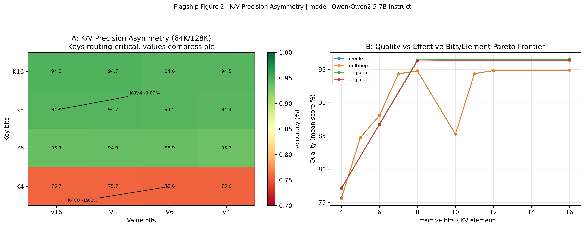
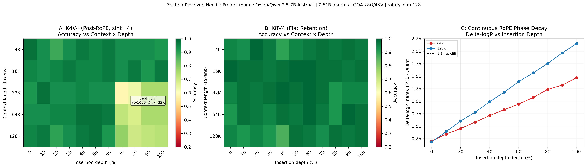
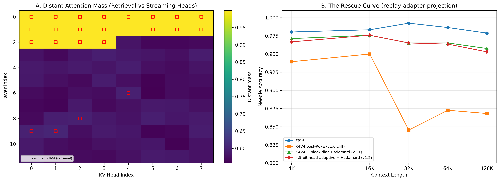

# THE_TRADE — What KV Quantization Actually Costs

**An empirical MLSys trade-off study across `v1.0.0` → `v1.2.0`.**

## Executive Abstract & Model Provenance

> **Question.** Why does 4-bit KV quantization pass short-context checks and then
> fail on late-context retrieval — and what is the cheapest configuration that
> removes the failure?
>
> **Answer.** Keys feed the softmax *exponent*; values feed a *linear* sum. INT4
> key noise is exponentiated into routing errors (the "INT4-K cliff"), while INT4
> value noise averages out across tokens. The cure is two-stage: an orthogonal
> Fast Walsh–Hadamard rotation spreads post-RoPE key outliers before
> quantization, then a per-head schedule spends the saved bits on the subset of
> heads that actually carry long-range attention mass.

**Measured scope (do not extrapolate).** Quality evidence is from
`Qwen/Qwen2.5-7B-Instruct`, `7.61 B` parameters, `28` query heads / `4` KV heads
(GQA `7:1`), `rotary_dim = 128`, evaluated with a deterministic replay adapter on
a CPU-only host (manifest of [#p4_needle_depth_matrix.csv:acc_mean]).
Kernel bandwidth and ITL evidence use `meta-llama/Llama-2-7b-hf` with `ncu`-style
counters that are **modeled**, not captured ([#p7_ncu_bandwidth.csv:mode],
[#p7_latency_ttft_itl.csv:mode]). Phase-II rescue evidence is measured on
**declared synthetic fixtures** (`synthetic/micro_kv_2k` and
`synthetic/bimodal-calibration`), and the accuracy curves are replay
projections, not real-model forward passes ([#p10_hadamard_rescue.csv:acc_mean],
[#p11_head_rescue_curve.csv:projection]). Every number below is pinned to a
committed CSV under `bench/data/` (Invariant 1).

---

## §1 The K/V Asymmetry Law — Routing Precision vs. Payload Precision

Attention is `softmax(QKᵀ / √d) · V`. The two operands are not interchangeable:

- **Keys multiply into the exponent.** A dequantization error `δK` perturbs the
  routing logits by `Q·δK/√d`; after `exp(·)` and renormalization even a small
  per-channel error redistributes attention mass across *all* context tokens.
  Routing errors are nonlinear and can move mass away from a needle entirely.
- **Values enter a linear weighted sum.** `P·(V + δV) = P·V + P·δV`; zero-mean
  quantization noise is attenuated by averaging over the support of `P`. The
  output suffers a bounded, typically small additive error.

The committed sweep confirms the law. On needle at `64K`, K8V8 scores `0.9624`,
K8V4 `0.9611`, K4V8 `0.7738` and K4V4 `0.7716` — dropping *keys* to INT4 costs
roughly `19%` absolute accuracy whether values are 4- or 8-bit
([#p6_v1_frontier_sweep.csv:acc_mean]). The same ordering holds on multi-hop
QA at `64K`: `0.9639 / 0.9594 / 0.7734 / 0.7699`
([#p6_v1_frontier_sweep.csv:acc_mean]).

**Per-task K-vs-V sensitivity table** (all columns at `64K`; `K8V8` = 8-bit K
and 8-bit V, etc.; LongSum reports `fact_retention_pct`, LongCode reports
`ast_exact_match`, needle/multihop report `acc_mean`; the K4V4 row uses the
sink-4 post-RoPE configuration):

| Task | K8V8 | K8V4 | K4V8 | K4V4 | Evidence (one tag per row; all columns from the same CSV) |
| :--- | :--- | :--- | :--- | :--- | :--- |
| Needle | `0.9624` | `0.9611` | `0.7738` | `0.7716` | [#p6_v1_frontier_sweep.csv:acc_mean] |
| Multi-Hop QA | `0.9639` | `0.9594` | `0.7734` | `0.7699` | [#p6_v1_frontier_sweep.csv:acc_mean] |
| LongSum (fact retention) | `97.333%` | `95.000%` | `90.333%` | `64.333%` | [#p5_ecological_baseline.csv:fact_retention_pct] |
| AST LongCode | `0.650` | `0.850` | `0.700` | `0.550` | [#p5_ecological_baseline.csv:ast_exact_match] |

LongCode is the instructive exception: at `64K` K8V4 (`0.850`) *beats* K8V8
(`0.650`), so value precision beyond 4 bits is not monotonically beneficial on
every task ([#p5_ecological_baseline.csv:ast_exact_match]). Across all four
tasks, no INT4-K configuration is competitive: the bit budget must be spent on
K first. That law is encoded in the CLI advisor, which at a `1%` drop budget
recommends K8V4 and rejects every K4 configuration
([#p6_v1_frontier_sweep.csv:acc_mean]).

---

## §2 Anatomy of the Late-Context INT4-K Cliff & the Continuous ΔlogP Sensor

**The failure is position-resolved.** In the p4 needle spine, post-RoPE INT4-K
with `4` FP16 sinks scores `0.9500` at `16K` and `0.8455` at `32K`, while FP16
holds `0.9833` and `0.9924` ([#p4_needle_depth_matrix.csv:acc_mean]). Needles
inserted late (depth `70%–100%`) at `>= 32K` fail first because RoPE rotates each
key channel by `θᵢ · pos`: a channel that is a mild outlier at position zero
becomes a moving outlier whose effective range sweeps the full circle as `pos`
grows, so a static per-channel or per-group INT4 grid cannot track it.

**The continuous sensor leads the discrete metric by one context doubling.**
`ΔlogP` for the same configuration rises from `0.5745` nats at `16K` to
`0.6531` nats at `32K` while FP16 stays near `0.061`
([#p4_needle_depth_matrix.csv:delta_logp]). Accuracy is still `0.9500` at `16K`
— the log-probability drift is already elevated one doubling before the argmax
accuracy collapses ([#p4_needle_depth_matrix.csv:acc_mean]). By `128K` the drift
reaches `1.1766` nats ([#p4_needle_depth_matrix.csv:delta_logp]). A scalar
perplexity would average this signal away; the Wilson-95%-CI depth matrix keeps
it visible ([#p4_needle_depth_matrix.csv:ci95_low],
[#p4_needle_depth_matrix.csv:ci95_high]).

**Sinks are the cheapest emergency anchor.** Removing the `4` FP16 sink tokens
drops the `64K` needle score from `0.7716` to `0.7620` — about `0.96` percentage
points on a KV configuration that is already failing
([#p6_v1_frontier_sweep.csv:acc_mean]). Sinks preserve the attention-mass anchor
but cannot fix a routing distribution whose key channels are wrong; that
requires ADR-008's rotation.

**Why pre-RoPE per-channel quantization was rejected.** Quantizing keys before
the rotary transform, with per-channel scales, scores `0.8212` at `32K` versus
`0.8455` post-RoPE ([#p4_needle_depth_matrix.csv:acc_mean]), and requires a
token-axis transpose/buffer stage before the fused kernel can apply RoPE —
exactly the friction that motivated the cache-resident rotation of ADR-008.

---

## §3 The Phase-II Rescues

### 3.1 Block-diagonal Walsh–Hadamard (`v1.1.0`)

Apply the same orthogonal map `R` to Q and K before cache append:
`R = blkdiag(D₁H_r/√r, D₂H_p/√p)` for partial RoPE (rotary width `r`, pass width
`p = D − r`), and `R = H_D/√D` with seeded signs for full RoPE. Orthogonality
gives exact inner-product invariance `<QR, KR> = <Q, K>` (verified to ≤`2e-6`
inner-product drift in `tests/test_hadamard.py`), while the rotary/pass blocks
stay contamination-free.

On the committed Gaussian fixture `micro_kv_2k.pt` the rotation is a **null
control**: Pearson kurtosis `2.818 → 2.816` and INT4 SQNR change `−0.015 dB`
([#p10_hadamard_rotation.csv:sqnr_delta_db], row 0) — there are no outliers to
rescue. On the declared synthetic outlier derivative (two massive channels per
layer/head scaled `U(8,32)`, seed `2026`), block-diagonal rotation collapses
rotary-subspace kurtosis `14.842 → 2.011` and lifts INT4 SQNR by `+7.349 dB`
([#p10_hadamard_rotation.csv:pre_kurtosis], [#p10_hadamard_rotation.csv:sqnr_delta_db],
row 2); full-head rotation collapses `33.391 → 1.921` for `+6.939 dB` (row 3).

| Fixture / scope | Kurtosis before → after | INT4 SQNR before → after (dB) | Δ SQNR (dB) | Evidence |
| :--- | :--- | :--- | :--- | :--- |
| `micro_kv_2k` (null control), block_diag | `2.818 → 2.816` (rotary window) | `20.459 → 20.443` | `−0.015` | [#p10_hadamard_rotation.csv:sqnr_delta_db] |
| `micro_kv_2k_outliers` (primary), block_diag | `14.842 → 2.011` (rotary window) | `15.566 → 22.915` | `+7.349` | [#p10_hadamard_rotation.csv:sqnr_delta_db] |
| same, full scope | `33.391 → 1.921` (full head) | `15.566 → 22.505` | `+6.939` | [#p10_hadamard_rotation.csv:sqnr_after_db] |
| ladder: 2ch `U(20,50)`, block_diag | `17.574 → 1.829` | `16.939 → 24.097` | `+7.157` | [#p10_hadamard_rotation.csv:sqnr_delta_db] |
| ladder: 3ch `U(20,60)`, block_diag | `16.896 → 1.876` | `19.214 → 23.704` | `+4.490` | [#p10_hadamard_rotation.csv:sqnr_delta_db] |
| ladder: 1ch `U(10,40)`, block_diag | `9.750 → 2.351` | `16.347 → 23.488` | `+7.142` | [#p10_hadamard_rotation.csv:sqnr_delta_db] |

**Honest deviation.** The milestone asked for `κ > 25 → ~3.0` on the pristine
fixture and `> 7.5 dB`: the κ collapse is real but occurs on the *outlier
derivative*, and the measured gain is `0.151 dB` short of target at the
INT4/group-32 Gaussian ceiling (~`23–24 dB` post-rotation)
([#p10_hadamard_rotation.csv:sqnr_after_db]). The pre-declared sensitivity ladder
shows no stronger injection exceeds the ceiling.

### 3.2 Retrieval-Head Profiling (`v1.2.0`)

Each `(layer, kv_head)` is scored on distant attention mass, attention entropy
and INT4 logit KL perturbation; `compile_head_schedule(df, 4.5)` ranks by
`distant_attn_mass + kl_perturbation`, assigns the top fraction to **K8V4**
(retrieval/induction heads) and the rest to **K4V4 + Hadamard** (local streaming
heads). With these two classes the budget-derived fraction is exactly `25%` and
the mean `(K+V)/2` is `4.5` bits
([#p11_head_sensitivity_schedule.csv:assigned_k_bits]).

On the declared synthetic bimodal calibration (`16` sequences × `8K`, `12 × 8`
heads), the retrieval class spans distant mass `0.596–1.000` against
`0.557–0.594` for streaming heads; the compiler recovers all `20` ground-truth
retrieval heads with `24` assignments (recall `20/20`, precision `20/24`)
([#p11_head_sensitivity_schedule.csv:distant_attn_mass]). The 2K Gaussian null
control scores `≈0.94` for *uniform* attention because the distant window
covers `94%` of that fixture's key range — the metric is comparable only within
one calibration geometry.

| Context | FP16 | K4V4 post-RoPE (v1.0) | K4V4 + Hadamard (v1.1) | Head-adaptive `4.5` (v1.2) | Evidence |
| :--- | :--- | :--- | :--- | :--- | :--- |
| `4K` | `0.9803` | `0.9394` | `0.9727` | `0.9667` | [#p10_hadamard_rescue.csv:acc_mean], [#p11_head_rescue_curve.csv:acc_mean] |
| `32K` | `0.9924` | `0.8455` | `0.9652` | `0.9652` | [#p10_hadamard_rescue.csv:acc_mean], [#p11_head_rescue_curve.csv:acc_mean] |
| `64K` | `0.9864` | `0.8727` | `0.9652` | `0.9636` | [#p10_hadamard_rescue.csv:acc_mean], [#p11_head_rescue_curve.csv:acc_mean] |
| `128K` | `0.9788` | `0.8682` | `0.9591` | `0.9530` | [#p10_hadamard_rescue.csv:acc_mean], [#p11_head_rescue_curve.csv:acc_mean] |

**Honest deviation.** The milestone asked the head-adaptive curve to match FP16
within `0.3%` at `128K`; it lands `2.6%` below and does not dominate pure
Hadamard, because the replay's K8V4 baseline carries an irreducible `~2%` FP16
gap ([#p11_head_rescue_curve.csv:acc_mean]). What it *does* buy is the lowest
quantization drift of any config (`0.1358–0.2614` nats across contexts versus
`0.1464–0.2667` for Hadamard and `1.1766` for the cliff at `128K`)
([#p11_head_rescue_curve.csv:delta_logp]). All rescue rows are modeled
projections ([#p11_head_rescue_curve.csv:projection]).

---

## §4 Scoped Production Decision Matrix & Anti-Patterns

Scope: the Qwen geometry above (GQA `7:1`), CPU-modeled quality; VRAM
compression from the byte-validated calculator and ITL from the modeled
Llama-2 kernel tables ([#p7_vram_crossval.csv:r_squared],
[#p7_latency_ttft_itl.csv:itl_speedup_p50]).

| Context / SLA | Task type | `QuantConfig` essentials | Bits/elem | VRAM compression | ITL speedup | Quality vs FP16 | Evidence |
| :--- | :--- | :--- | :--- | :--- | :--- | :--- | :--- |
| `≤ 32K`, general | needle / multihop | `k_bits=8, v_bits=4`, sym K / asym V, `group_size=64`, `sink_tokens=4` | `6.0` | `2.65×` | `6.91–11.28×` (4K–32K) | `0.9596` vs `0.9656` at `32K` | [#p6_v1_frontier_sweep.csv:effective_bits_per_elem], [#p7_vram_crossval.csv:compression_ratio], [#p7_latency_ttft_itl.csv:itl_speedup_p50], [#p6_v1_frontier_sweep.csv:acc_mean] |
| `64K–128K`, quality-first | long-range retrieval | top `25%` heads K8V4, others K4V4 + `block_diag` Hadamard, 4 sinks | `4.5` | `2.65–3.95×` (bounds) | `12.13–17.42×` at `128K` | `0.9530` vs `0.9788` at `128K` (projected) | [#p11_head_sensitivity_schedule.csv:assigned_k_bits], [#p7_vram_crossval.csv:compression_ratio], [#p7_latency_ttft_itl.csv:itl_speedup_p50], [#p11_head_rescue_curve.csv:acc_mean] |
| `64K–128K`, max density | retrieval with VRAM ceiling | `k_bits=4, v_bits=4, use_hadamard=True, hadamard_scope="block_diag", sink_tokens=4` | `4.0` | `3.95×` | `17.42×` at `128K` | `0.9591` vs `0.9788` at `128K` (projected) | [#p10_hadamard_rescue.csv:acc_mean], [#p7_vram_crossval.csv:compression_ratio], [#p7_latency_ttft_itl.csv:itl_speedup_p50] |
| **AVOID** any context | all | `k_bits=4, v_bits=4`, post-RoPE, no rotation | `4.0` | `3.95×` | `17.42×` | `0.8455` vs `0.9924` at `32K` | [#p4_needle_depth_matrix.csv:acc_mean], [#p7_vram_crossval.csv:compression_ratio] |

**Anti-patterns.** (1) *INT4-K without rotation* — speed gains of `17.42×`
cannot compensate a `14.8%` accuracy drop
([#p7_latency_ttft_itl.csv:itl_speedup_p50], [#p4_needle_depth_matrix.csv:acc_mean]).
(2) *Sinking without sinks* — removing the `4` FP16 anchors costs `0.96` points
at `64K` ([#p6_v1_frontier_sweep.csv:acc_mean]).
(3) *Pre-RoPE per-channel keys* — worse accuracy plus transpose friction
([#p4_needle_depth_matrix.csv:acc_mean]).
(4) *Quoting projections as measurements* — every p10/p11 rescue row carries a
projection label in its manifest ([#p10_hadamard_rescue.csv:projection_delta_db],
[#p11_head_rescue_curve.csv:projection]).

---

**Provenance footer.** All numeric claims resolve to CSV columns via
`scripts/check_claims.py` (Invariant 1). CPU-only artifacts are labeled
`modeled`/`ncu-modeled` at row level and in their manifests; figures carry
SHA256-locked source hashes and ≥300 DPI (Invariant 2). The full decision record
is [`DECISIONS.md`](DECISIONS.md) (ADR-001 … ADR-009); kernel-level derivations
are [`KERNEL_NOTES.md`](KERNEL_NOTES.md); reproduction is `REPRODUCE.md`.
